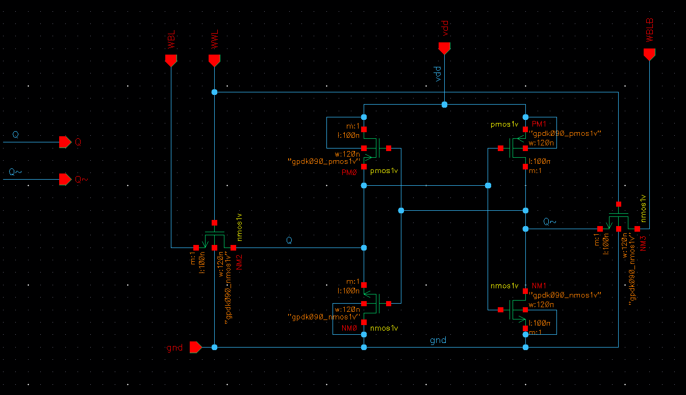
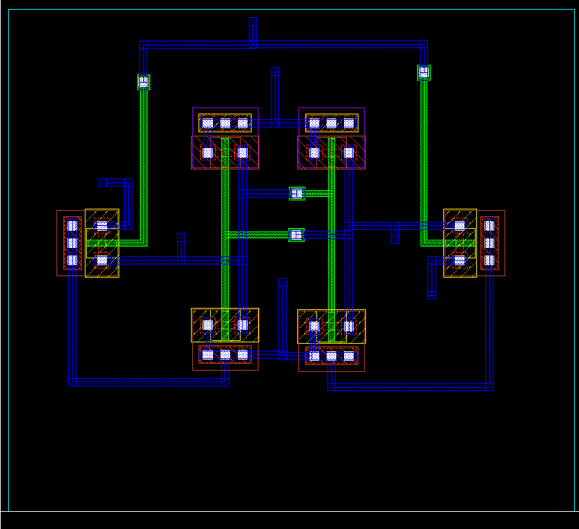
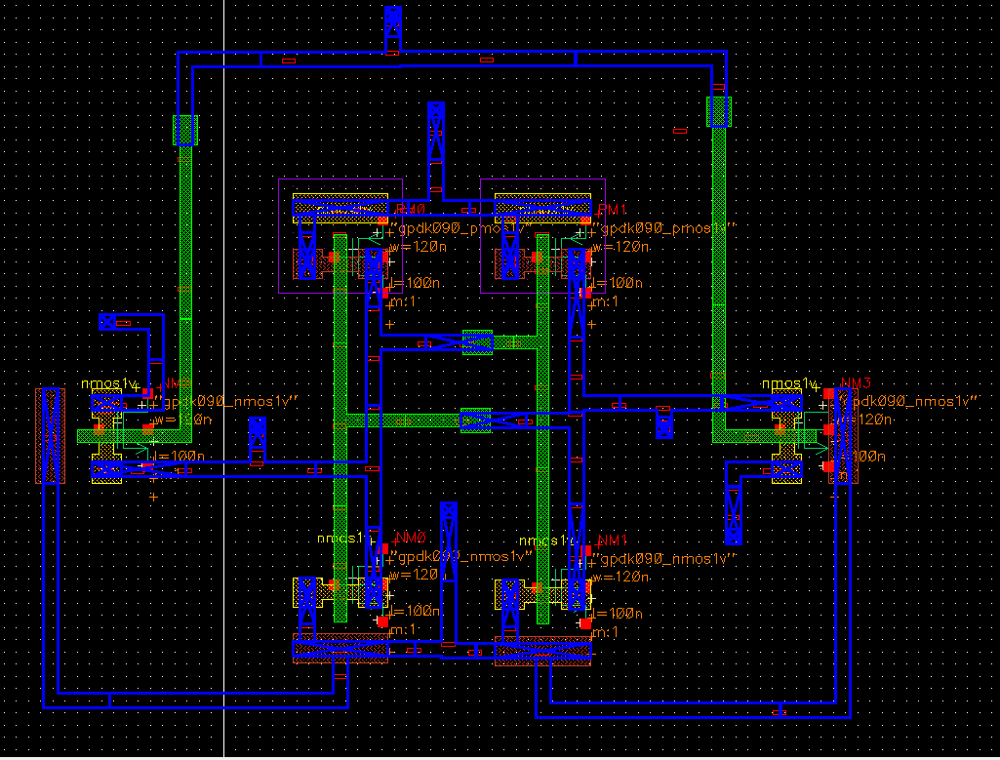

# 6T SRAM Cell — GPDK090

## Overview

This project contains the transistor-level schematic, full-custom layout, and extracted view of a conventional six-transistor SRAM bit cell implemented with the GPDK090 90 nm CMOS process.

The cell uses two cross-coupled CMOS inverters to store one bit and two access NMOS transistors controlled by the word line (`WL`). The complementary bit lines are `BL` and `BLB`.

## Design views

### Schematic

### Layout

### Extracted view

## Tools and process

- Cadence Virtuoso
- GPDK090 90 nm CMOS
- Supply voltage: 1.2 V
- Transistor dimensions shown in the schematic: W/L = 120 nm/100 nm
