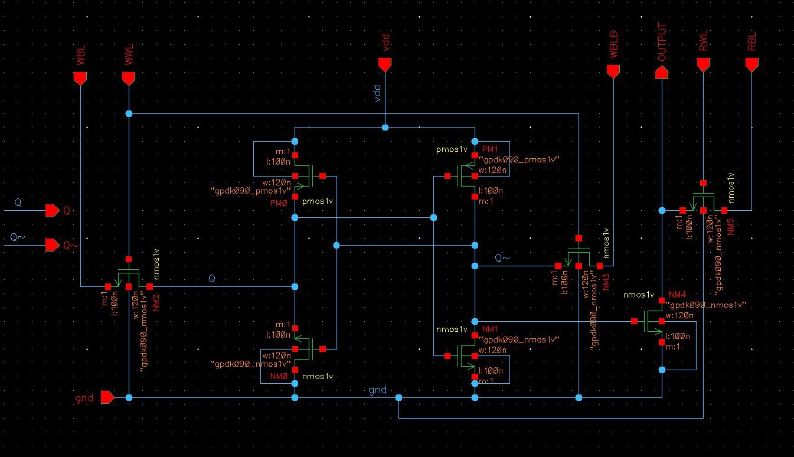
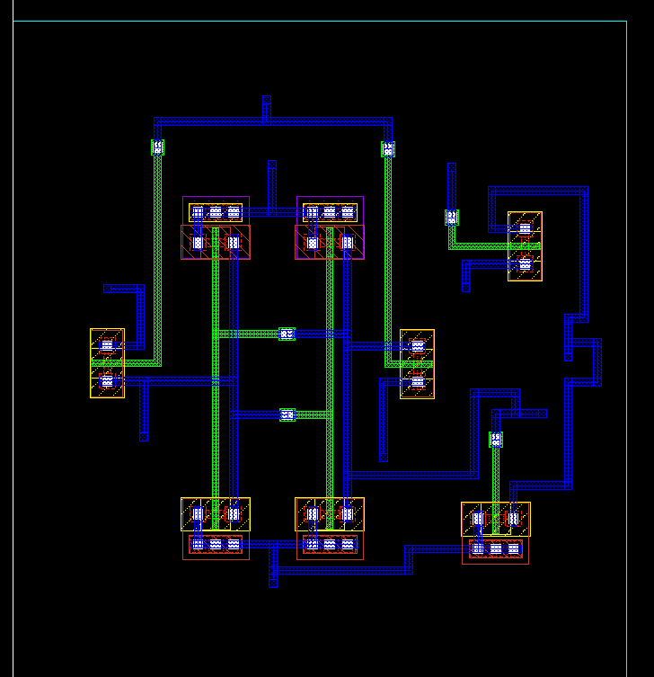
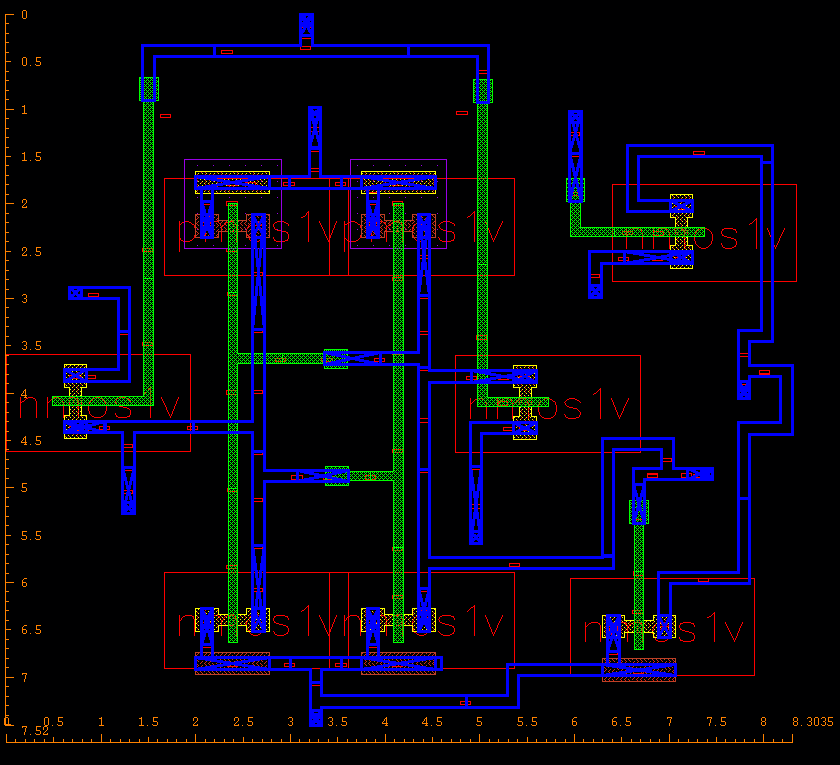

# 8T SRAM Cell — GPDK090

## Overview

This project contains the transistor-level schematic, full-custom layout, and extracted view of an eight-transistor SRAM bit cell implemented with the GPDK090 90 nm CMOS process.

The 8T cell extends the conventional 6T storage core with a separate read path. Its read word line (`RWL`) and read bit line (`RBL`) isolate read activity from the internal storage nodes, while `WWL`, `WBL`, and `WBLB` form the write path.

## Design views

### Schematic

### Layout

### Extracted view

## Tools and process

- Cadence Virtuoso
- GPDK090 90 nm CMOS
- Supply voltage: 1.2 V
- Transistor dimensions shown in the schematic: W/L = 120 nm/100 nm
